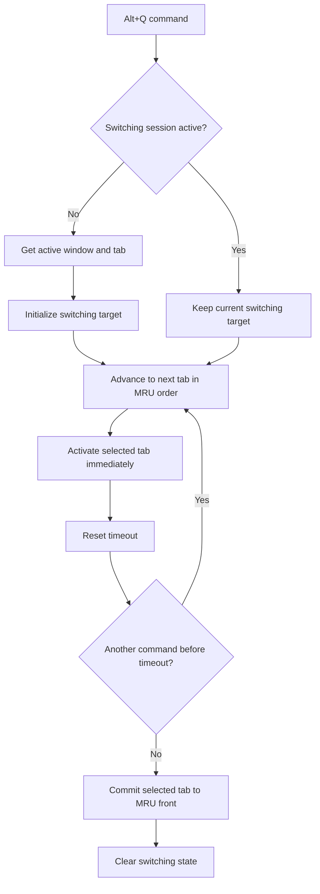

# Vestor

A simple chrome extension for switching between different tabs.

> [!NOTE]
> Add more notes here about usage and other stuff

## Overall architecture

For now, timeouts are being used as a way to keep track what the user
wants to do. Need to later add something more precise.

***Other things to keep in mind***;

| Situation | Handling |
| --- | --- |
| New tab created	| Add its ID to the correct window's list. |
| Tab closed |	Remove its ID; if it was the switching target, choose a valid remaining tab. |
| Tab moved to another window	| Remove it from the old window's list and add it to the new one. |
| User switches tabs manually	| Move that tab to the front, unless it is an activation caused by Vestor's current switching session. |
| User switches browser windows	| Start cycling in the newly active window, using that window's MRU list. |